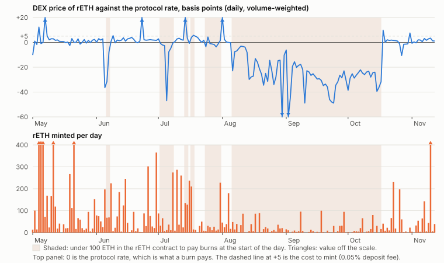

# Why isn't rETH being minted? Findings

Ethereum mainnet, 2026-05-01 to 2026-11-13 (end block 26,403,103), 196 full days. Everything below comes from
contract event logs and contract state read through public RPC. Scripts in `scripts/`, daily table in
`data/daily.csv`, every number in `data/results.json`.

## Answer

rETH is not minted because it is almost never the cheapest way to get rETH, and for half the window it was
clearly the most expensive. The lever is the ETH held in the rETH contract to pay burns. When that balance is
empty, holders can only leave through the DEX, rETH trades about 25 bps under the protocol rate, and minting
at the rate plus the 0.05% fee makes no sense. When it is funded, the price snaps back to the rate within a day
and mints run four times higher.

The deposit side is not the problem. The pool never held more than 32 ETH against a 6.0M ETH cap, deposits
were enabled throughout, and between 634 and 2,360 validators were queued for pool ETH every day.

## The four numbers behind it

| | Burn collateral empty (94 days) | Funded (102 days) |
|---|---|---|
| DEX price against the rate, median | -23.8 bps | +1.7 bps |
| rETH minted per day, mean | 29.6 | 125.5 |
| Days when buying on the DEX beat minting, 10 ETH | 95% | 74% |
| rETH burned per day, mean | 161.6 | 270.3 |

"Empty" means under 100 ETH in the rETH contract at the first block of the day. The longest spell ran 73 days,
2026-08-06 to 2026-10-17. On 2026-10-18 the balance went from 0 to 2,714 ETH. The seven-day average price went
from -29.5 bps to +2.6 bps and mints from 21 to 57 rETH per day.

## What else the record shows

- **Net flow is out, in both regimes.** 15,580 rETH minted in 1,407 transactions; 42,759 burned in 23,231.
  Supply fell from 333,009 to 305,830, down 8.2%. Even on funded days burns were twice mints.
- **The price sits at the floor, not the ceiling.** 78% of DEX volume (71,740 ETH across the Uniswap v3 0.01%
  and v4 rETH/ETH pools) traded below the protocol rate. The price was above the +5 bps mint cost on 10 days.
- **The fee is the gap on good days.** On funded days minting was cheaper than the DEX 26% of the time. With a
  zero deposit fee it would have been 95%.
- **The yield is behind.** Over the window the rETH rate grew 2.11% annualised against 2.40% for stETH (from
  Lido's rebase events). The trailing 30-day rETH yield was above stETH on 15 of 166 days. On the route ladder
  for 10 ETH held one year, stETH was best on 92 days, DEX-bought rETH on 74, minted rETH on none.
- **Daily price does not predict daily mints.** Regressing mints on the previous day's premium gives t = 1.5,
  R² = 0.01. The effect is a regime, not a slope: a funded-collateral dummy gives +96 rETH per day, t = 3.4.
- **October.** 62,066 ETH was recycled into the deposit pool and 58,528 ETH was assigned to queued validators
  (53,504 on 2026-10-22, queue 2,330 to 663). Burn collateral ended the month at 2,231 ETH. Cause not traced.

## Cause and direction

Full detail in `cause/FINDINGS.md`. Mints supply only 13% of the ETH reaching the buffer; node operators' payouts supply
81%, so low minting cannot be the main reason it is empty. While rETH trades at a discount, arbitrage burns take each
arriving ETH, usually within one block: all 16 refills during the 73-day spell were emptied within the hour. Hour by
hour, a funded buffer predicts about 80 more rETH minted over the next day after controlling for the previous day's
minting (t 4.7). The reverse effect exists but is small. Two of the four new predictions passed, one failed and one
could not be tested.

## Buffer size

Full detail in `sizing/FINDINGS.md`. The long spell was an inflow drought: ETH into the buffer fell from about 11,000 a
month in May and June to 3,400-5,000 from July to September, against estimated exit demand of 10,000-12,000. From June
to September nothing reached the 1% cap, so a higher target alone would have changed nothing. Covering such a drought
needs ETH held in advance: about 5% of rETH value would have paid every exit on roughly 9 days in 10, at about 11 bps of
holder yield a year. Saturn 2's queue without forced exits would have left a long tail of waits.

## Against rival staking tokens and earlier work

The full comparison is in `peers/FINDINGS.md`. In short: when its buffer was funded, rETH stayed within 10 bps of
its rate on 100% of days, better than stETH (97%). With the buffer empty it managed 32%, worse than every rival except
osETH. Rivals with withdrawal queues but thin markets (ETHx, osETH) also traded well under their rates, so the queue
voted for in Saturn 2 will not on its own remove the discount. RPIP-71 keeps a 1% buffer, so its size still matters.

The discount itself is known. A Round 41 application (filipe.leonor, 2026-09-22) measured rETH below its rate on 69%
of 364 days. What is new here is the link to the rETH contract's own balance, the measured effect on minting, and the
comparison with rivals. Sources in `peers/SOURCES.md`.

## Checks against things that are not us

| Check | Result |
|---|---|
| Mints minus burns equals the change in `totalSupply()` over the window | Exact. Difference 0 wei. |
| DEX price against the Chainlink RETH/ETH market feed, all 196 days | Median gap 0.6 bps; 99.5% of days within 10 bps. On empty days both read -19 bps at the day's first block. |
| Protocol rate against Chainlink within 5 bps (as written in the brief) | **Fail, and mis-specified.** That feed is a market price, not the exchange rate. Up to 31 bps apart on the sample, because the market was at a discount. Used as the row above instead. The rate itself has no independent check here. |
| DEX price against CoinGecko rETH/ETH within 10 bps | **Fail.** 5% of days within 10 bps, median gap 27 bps. CoinGecko read about 20 bps above the DEX and Chainlink during the discount. Unexplained. |

## Predictions fixed before the data (PREDICTION.md)

1. Premium days have at least 3x the mints of discount days: **fail**. Mean ratio 2.0x, median 3.6x, on 86
   premium and 110 discount days. The test was the mean.
2. Price stays between the rate and the rate plus 5 bps on 90% of days: **fail**. 39% of all days, 71% of
   funded days, 4% of empty days.

The collateral split was found after these failed. It is post-hoc and should be tested on data after 2026-11-13.

## Limits

- Two venues. CoW, aggregator fills from other sources, Balancer v3 and Curve are not priced.
- The protocol rate is a daily step, so intraday premium is overstated by up to about 0.6 bps.
- Collateral is read once a day. Burns continued on empty days (162 rETH per day) as ETH arrived and left
  inside the day; 93% of burn transactions were under 1 rETH.
- The ladder assumes rETH exits at the rate, ignores gas, and uses stETH APR / 0.9 for native staking.
- Not traced: why the collateral ran out, what caused the October recycle, why the rETH yield is behind.
- Mainnet only. No L2 venues.
