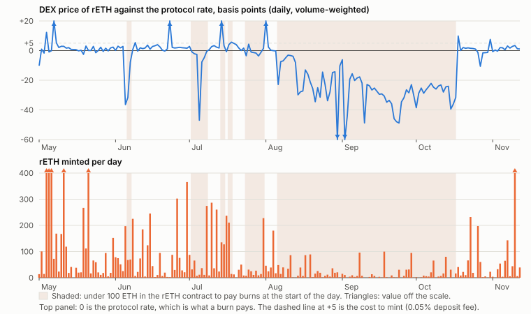

# rETH exit liquidity

When the rETH contract runs out of ETH to pay burns, rETH trades below its protocol rate and minting falls.
This repo measures that on Ethereum mainnet from 2026-05-01 to 2026-11-13, and compares rETH with five other
liquid staking tokens over the same days.

Results: [FINDINGS.md](FINDINGS.md). Cause and direction, block by block: [cause/FINDINGS.md](cause/FINDINGS.md). Rival tokens: [peers/FINDINGS.md](peers/FINDINGS.md).
Predictions written before the data: [PREDICTION.md](PREDICTION.md), [cause/PREDICTION.md](cause/PREDICTION.md), [peers/PREDICTION.md](peers/PREDICTION.md).



## Data
Everything comes from public Ethereum RPC endpoints: contract event logs and archive `eth_call` reads.
No API keys, no paid data, no dashboards. CoinGecko and Chainlink are used only as outside checks.

| File | What it is |
|---|---|
| `data/daily.csv` | One row per day: rETH supply, rate, burn collateral, deposit pool, mints, burns, DEX price against the rate |
| `data/daily_state.csv` | Contract state at the first block of each UTC day |
| `data/results.json` | Every number quoted in FINDINGS.md |
| `peers/daily_peers.csv` | Rate, supply and market price for rETH, stETH, cbETH, ETHx, osETH, mETH |
| `peers/chainlink_daily.csv` | Chainlink market feeds on the same days |

The raw event logs (about 70 MB) are not committed. `scripts/01_pull.py` rebuilds them.

## Re-run
Python 3.11 or later, standard library only.

```
python3 scripts/01_pull.py          # raw logs, about an hour on public endpoints
python3 scripts/02_daily_state.py   # daily contract state
python3 scripts/03_analyze.py       # daily table, tests, reconciliations -> data/results.json
python3 scripts/04_chart.py         # chart
python3 scripts/20_buffer_events.py # rETH contract inflows, mints, burns
python3 scripts/21_cause.py         # block-level buffer, refills, direction test -> cause/
python3 scripts/11_peer_daily.py    # rival tokens
python3 scripts/12_oseth_swaps.py
python3 scripts/13_peer_compare.py
python3 scripts/14_peer_chainlink.py
```

`data/discovery.json` fixes the window and end block (26,403,103). Keep it to reproduce these numbers exactly;
`scripts/00_discover.py` resets it to the current head for a new window.

## Checks
- Mints minus burns equals the change in rETH `totalSupply()` over the window, to the wei.
- The DEX price matches the Chainlink RETH/ETH market feed within 10 bps on 195 of 196 days.
- Rival prices are checked against Chainlink where a feed exists, and against CoinGecko for osETH.
- The block-level buffer rebuild matches the true balance within 0.035 ETH at 60 random low-balance blocks; every refill used is confirmed against the true balance.
- Failed predictions are reported: two of two in the first rETH test, two of three in the rival comparison, one of four in the cause test (and one could not be tested).

## Licence
MIT. Data derived from public chain state.
