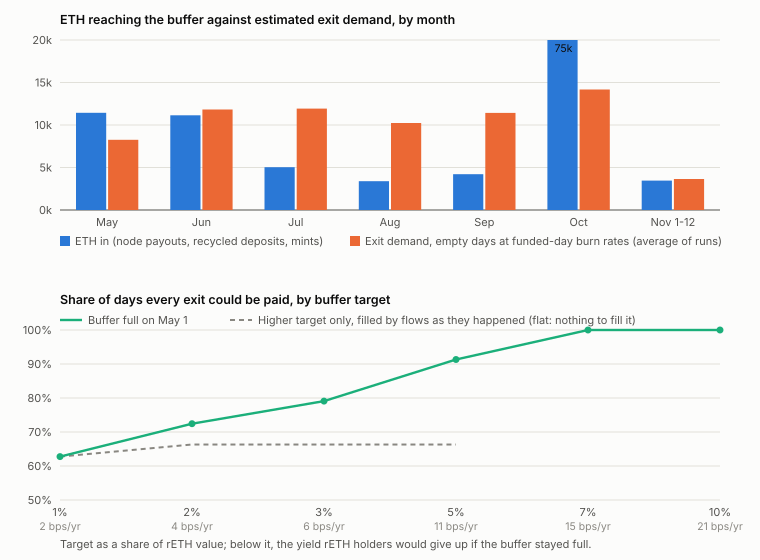

# How big should rETH's exit buffer be?

Daily replay of the real flows, 2026-05-01 to 2026-11-12, through buffers of different sizes. Script
`scripts/22_sizing.py`, chart `charts/2_sizing.svg`, numbers in `results.json`. Predictions fixed beforehand in
`PREDICTION.md`.

## Answer

The August to October spell was an inflow drought, not a target that was too small. From June to September the buffer
never reached its 1% cap, so a higher target would have held no extra ETH. Raising the target only helps when a flood
arrives: in October 61,658 ETH passed through the cap to queued validators, and a 5% target would have kept about
14,400 ETH of it for the next drought. To ride out a drought like this one from the start, the buffer has to hold the
ETH already. About 5% of rETH value would have paid every exit on roughly 9 days in 10, and about 7% on all of them, at
a cost to holders of 11 and 15 bps of yield a year. Saturn 2 (RPIP-71) adds a queue with forced exits whenever the
shortfall passes 120 ETH, about 5 days to free ETH by its own estimate, so under Saturn 2 waits are bounded by the exit
process, not by inflows. The open trade-off there is wait time against forced exits of node operators against idle ETH
in the deposit pool buffer.

## Where the ETH came from and where demand was

| Month | ETH into the buffer | Estimated exit demand | Forwarded above the 1% cap |
|---|---|---|---|
| May | 11,439 | 8,257 | 408 |
| June | 11,139 | 11,821 | 0 |
| July | 5,040 | 11,934 | 0 |
| August | 3,391 | 10,237 | 0 |
| September | 4,216 | 11,426 | 0 |
| October | 74,510 | 14,171 | 61,658 |
| November 1-12 | 3,456 | 3,645 | 0 |

Exit demand is S2: on days the real buffer was empty, burns at the rate seen on funded days, as a share of supply
(1,000 runs); other days as observed. On empty days, observed burns could never exceed inflow, so they understate demand.

## Days every exit could be paid (S2, median of runs)

| Target | Higher target, filled by flows as they happened | Buffer full on May 1 | Yield cost if always full |
|---|---|---|---|
| 1% (today) | 63% | 63% | 2.1 bps a year |
| 2% | 66% | 72% | 4.2 |
| 3% | 66% | 79% | 6.3 |
| 5% | 66% | 91% (80-100%) | 10.6 |
| 7% | | 100% (90-100%) | 14.8 |

For comparison, an exit through the DEX on an empty day cost about 24 bps.

The buffer that would never have run dry under S2, with no cap: 25,400 ETH, 6.8% of rETH value (95th percentile 34,600,
9.2%). With the worst observed week added at the start of the spell: 32,200 ETH, 8.6%.

## A queue with no forced exits (not Saturn 2)

Correction, 2026-11-15: an earlier version presented the table below as Saturn 2's outcome, and the 47-day tail was
quoted in public as such. It is not. RPIP-71 forces exits when the queue's shortfall passes `exit_hysteresis`
(120 ETH initially), sized to cover it, and estimates about 5 days for that ETH to arrive. The replay below has no
forced exits, so it shows only what a queue served by inflows alone would have done: the case Saturn 2's exit rule is
there to prevent. S2 demand also includes arbitrage burns that would not occur with rETH at its rate, so it likely
overstates demand under Saturn 2.

Replay with S2 demand, a 1% buffer, and unpaid exits queued first-in first-out and served by later inflows only.

| ETH-weighted wait | Days |
|---|---|
| Median | 5 |
| 90th percentile | 47 |
| Share of exit ETH waiting over 7 days | 45% |
| Largest queue | 21,300 ETH |

For scale, ETHx's 7-10 day queue went with a median discount of about 8 bps over the same months (peers/FINDINGS.md).

## The trade-off the DAO is choosing

- ETH held in the buffer is ETH not sent to queued node operators. The 14,400 ETH a 5% target would have kept in
  October is about 500 validators at 28 ETH each, against a queue of about 670 today.
- Idle ETH costs every holder about 2.1 bps a year per 1% of target. A spell like August to October costs each exiting
  holder about 24 bps per exit, and cut minting to about a quarter.
- Three levers, which can be combined: a higher target that keeps more of the next flood; ETH held in reserve before a
  drought; and, after Saturn 2, the deposit pool buffer size, which sets how often validators are force-exited.

## Predictions

- P10, under observed burns some target at or below 3% pays every exit on 90% of days: **pass, but empty**. Observed
  burns could only happen when ETH was there, so this scenario pays almost every day at any target. The test was
  badly designed; S2 is the one that means something.
- P11, that target costs under 5 bps a year: **pass, same caveat**.
- P12, under S2 no target at or below 3% reaches 90% of days: **pass**. 66% at most when filled by flows, 79% pre-filled.
- P13, Saturn 2 median wait under 7 days: **not a valid test**. The replay had no forced exits, so it does not model
  Saturn 2. Its 5-day median and 47-day tail describe a queue served by inflows alone.

## Limits

- Latent exit demand on empty days is estimated, not observed. Funded-day burns include some arbitrage, which could
  overstate it; a funded buffer also raises minting and so inflow, which this replay leaves out and could understate it.
- Daily resolution. Mints are held as they happened, not raised on funded days.
- The pre-filled runs were added after the pre-registered ones.
- The yield cost uses the rETH rate's growth over the window, 2.11% a year.
